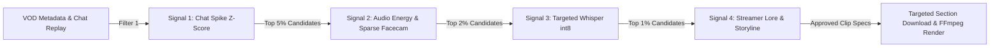

# ADR 002: Multi-Genre Studio Architecture & Coarse-to-Fine Multimodal Gaming Clips Funnel

- **Status:** PROPOSED
- **Date:** 2026-11-21
- **Deciders:** `spec-architect`, `phase-orchestrator`
- **Target Phase:** Phase G1 (`refactor/phase-g1-gaming-clips-mvp`)

---

## 1. Context & Problem Statement

`Content-Creation-Automation` was originally architected as a single-vertical editorial pipeline transforming machine learning and AI research publications into educational content assets (video scripts, carousels, briefs). While the core platform services (WAL-mode SQLite persistence, job queue, lock management, human review state machines, weekly calendar planning, and telemetry) are robust, domain-agnostic, and production-hardened, the platform currently lacks multi-vertical capability.

A high-impact expansion opportunity is **Gaming & Streamer Highlight Clipping** (Twitch, YouTube Gaming, Kick). Live streams represent a massive content volume (4–8 hours per stream, 10–40 GB per VOD), but video editors and content creators face severe friction in mining viral 30–90 second vertical shorts (TikTok, Reels, Shorts).

### The Technical Dilemma of Gaming VOD Clipping
Existing tools fall into two unsatisfactory extremes:
1. **Cloud-Heavy SaaS (e.g., OpusClip, Klap, Munch):**
   - Require uploading massive 20+ GB VOD files over consumer upstream connections.
   - Run expensive, full-duration cloud speech-to-text models on multi-hour silent gameplay, incurring high per-minute costs.
   - Lack deep streamer context, running jokes, and channel lore, producing generic, uninspired cuts.
2. **Naive Local Open-Source Tools (e.g., `iamajmeena/neonclipping`):**
   - Provide local execution speed but rely on basic speech activity detection, producing jarring cuts in the middle of streamer sentences.
   - Employ unbuffered, hyperactive facial tracking that creates dizzying, shaky camera switching whenever the streamer tilts their head or glances at their second monitor.
   - Ignore live chat sentiment and audio decibel spikes—the two most reliable indicators of funny, chaotic, or clutch gaming moments.

### The System Challenge
To support this vertical on typical creator hardware, the system must operate under **Strict Low-Config PC Constraints**:
- Single-machine, native Windows execution (`.agents/skills/windows-python-hygiene/SKILL.md`).
- Peak RAM consumption under **2.0 GB**.
- **CPU-only inference** (no CUDA or high-end GPU requirement).
- **Zero full-VOD 1080p downloads** (eliminating 20+ GB disk thrashing).
- Strict non-interference with existing Educational pipeline modules and secondary channels (`newsletter`, `linkedin_post`).

---

## 2. Decision Drivers

- **Multi-Genre Studio Pluggability:** Allow seamless switching between `Educational Content Studio` and `Gaming Clips Studio` via a pluggable domain registry without duplicating core platform services (SQLite, jobs, review gates, calendar, analytics).
- **Coarse-to-Fine Computational Funnel:** Discard 95% of non-highlight stream duration using ultra-lightweight signals (Chat Spike Z-scores and coarse audio energy) before executing speech-to-text or visual parsing.
- **Extreme Bandwidth & Storage Efficiency:** Leverage byte-range section fetching (`yt-dlp --download-sections`) to retrieve only shortlisted 30–90s video slices, never downloading multi-gigabyte full VODs.
- **Low-Config PC Hardware Viability:** Ensure CPU-only execution with quantized speech models (`faster-whisper` `int8`) and single-worker sequential FFmpeg rendering capped at $\le 2\text{ GB}$ peak RAM.
- **Streamer Storyline & Lore Awareness:** Incorporate streamer persona, running jokes, and game context to craft engaging hooks, punchlines, and virality scoring.
- **Strict Architectural Invariants & Windows Hygiene:** Adhere to `AGENTS.md` §6.1, explicit UTF-8 I/O, subprocess safety, and secret hygiene (`.agents/skills/security-and-cost-guard/SKILL.md`).

---

## 3. Considered Options

### Option 1: Coarse-to-Fine 4-Signal Multimodal Funnel with Domain Plugin Architecture (Chosen)
- Introduce a **Home Page Genre Router** toggling between `Educational Content Studio` and `Gaming Clips Studio` on top of shared platform infrastructure.
- Implement a hierarchical 4-signal selection funnel:
  1. **Signal 1 (Live Chat Spike Z-score):** Ingest and parse timestamped chat replay (Twitch JSON / YouTube Replay) to calculate rolling message density and emote velocity ($Z > 2.5$).
  2. **Signal 2 (Audio Energy & Sparse Facecam Box):** Analyze coarse audio decibels/RMS for screams, gasps, and laughter. Extract sparse keyframes to locate and clamp static facecam regions without continuous optical flow tracking.
  3. **Signal 3 (Targeted `faster-whisper` `int8` CPU Transcription):** Transcribe only the 30–90 second shortlisted audio slices on CPU to extract word-level timestamps and punctuation.
  4. **Signal 4 (Persistent Streamer Lore & Storyline Memory):** Evaluate highlight narrative via a lightweight LLM agent grounded in streamer lore and game meta.
- Download candidate video ranges via `yt-dlp --download-sections` and render vertical 9:16 shorts via single-worker FFmpeg filtergraphs.

### Option 2: Full-VOD Local Ingestion with Continuous OpenCV Face Tracking & Global Whisper
- Download complete 1080p VODs locally.
- Run continuous face detection and speech-to-text across the entire 4–8 hour duration.
- *Rejected because:* Downloading 15–30 GB files saturates consumer disks and bandwidth. Running Whisper across 6 hours on a CPU takes 3+ hours and causes severe thermal throttling. Continuous per-frame face tracking exceeds the 2.0 GB memory limit.

### Option 3: Third-Party Cloud API Delegation (SaaS Wrapper)
- Dispatch video URLs to external cloud APIs (e.g., OpusClip, Klap, AWS Transcribe).
- *Rejected because:* Violates local-first architecture, requires expensive recurring subscription/API costs ($15–$50 per stream), sends private creator content to third parties, and fails when creators are offline.

---

## 4. Decision Outcome

**Chosen: Option 1.**

### 4.1 Home Page Genre Router & Studio Architecture

The presentation and domain architecture is refactored into a Multi-Genre Studio structure. The Streamlit Home Page (`src/content_creation/ui/app.py`) provides a top-level Genre Router:

```mermaid
flowchart TD
    subgraph UI Presentation Tier
        A[Streamlit Entrypoint: app.py] --> B{Genre Router}
        B -->|Genre: Educational| C[Educational Content Studio]
        B -->|Genre: Gaming Clips| D[Gaming Clips Studio: 7_gaming_clips.py]
    end

    subgraph Core Platform Services (Shared Single Source of Truth)
        E[(SQLite DB: content_factory.db)]
        F[Jobs Queue & Lock Manager]
        G[Review Transition Engine]
        H[Posting Planner & Calendar]
        I[Observability & Analytics]
    end

    subgraph Domain Subsystems
        C -->|Pipelines & Artifacts| J[src/content_creation/domains/brief, script, carousel...]
        D -->|Coarse-to-Fine Funnel| K[src/content_creation/domains/gaming_clips/]
    end

    J --> E
    J --> F
    J --> G
    J --> H
    J --> I

    K --> E
    K --> F
    K --> G
    K --> H
    K --> I
```

#### Shared Platform Invariant
Both verticals share identical core platform primitives:
- **Persistence:** Unified WAL-mode SQLite database (`data/content_factory.db` / `data/*.db`).
- **Review State Machine:** The universal `ReviewStatus` enum (`draft` $\rightarrow$ `needs_review` $\rightarrow$ `approved` $\rightarrow$ `rejected`) in `src/content_creation/shared/enums.py`.
- **Job Engine:** In-process single-worker queue engine with advisory locking (`src/content_creation/jobs/`).
- **Calendar & Publishing:** Weekly publication planner and dry-run validator (`src/content_creation/planning/`).

---

### 4.2 The Coarse-to-Fine 4-Signal Multimodal Funnel

To achieve near-instant highlight identification without exhausting CPU or RAM, the pipeline processes data through four progressively granular filters:



#### Signal 1: Live Chat Spike Z-Score Filter
- **Input:** Chat replay stream (Twitch JSON, YouTube Live Chat, or IRC logs) containing timestamps, user IDs, and text messages.
- **Windowing:** Sliced into rolling time windows $W_t$ of 30 seconds with 10-second slide increments.
- **Intensity Formulation:**
  For each window $t$, calculate the weighted message velocity $M(t)$:
  $$M(t) = \sum_{m \in W_t} \left( 1.0 + w_{\text{emote}} \cdot \mathbb{I}_{\text{emote}}(m) + w_{\text{caps}} \cdot \text{CapsRatio}(m) + w_{\text{punct}} \cdot \mathbb{I}_{\text{punct}}(m) \right)$$
  Where:
  - $w_{\text{emote}} = 1.5$ for gaming hype emotes (`KEKW`, `OMEGALUL`, `LUL`, `POG`, `W`, `L`, `CLIP IT`, `NO WAY`, `SHEESH`).
  - $w_{\text{caps}} = 1.0$ if uppercase character ratio exceeds 60%.
  - $w_{\text{punct}} = 0.5$ if message contains multiple `!` or `?`.
- **Spike Detection via Z-Score:**
  Using a baseline rolling mean $\mu_t$ and standard deviation $\sigma_t$ over a 10-minute window:
  $$Z(t) = \frac{M(t) - \mu_t}{\sigma_t}$$
- **Threshold Gate:** Candidate windows with $Z(t) \ge 2.5$ pass to Signal 2. Overlapping or adjacent windows within 20 seconds are merged into candidate clip clusters (duration: 30s to 90s).

#### Signal 2: Audio Energy Peak & Sparse Facecam Box
- **Audio Energy (RMS Decibels):**
  - Download coarse, low-bitrate audio stream (`yt-dlp -f "ba[ext=m4a]/ba"` or extract audio from shortlisted candidate time ranges).
  - Calculate Root Mean Square (RMS) decibel levels across candidate clusters:
    $$\text{RMS}_{\text{dB}} = 20 \log_{10} \left( \sqrt{\frac{1}{N} \sum_{i=1}^N s[i]^2} \right)$$
  - Detect high-energy vocal bursts (screams, laughter, abrupt hype) and sudden post-clutch drops (shock/silence). Candidates lacking audio energy confirmation ($< -24\text{ dB}$) are penalized or dropped.
- **Sparse Facecam Clamping (Anti-Shaky Face Heuristic):**
  - Rather than running heavy per-frame face tracking across thousands of frames, sample **one frame every 5 seconds** across the clip.
  - Detect the static streamer facecam region (typically top-left, top-right, or bottom-left).
  - Calculate the bounding box union: once the facecam box coordinates $(x, y, w, h)$ are established, **lock and clamp** them statically for the clip duration.
  - This eliminates the jarring, hyperactive camera shakes common in naive auto-framers.

#### Signal 3: Targeted `faster-whisper` `int8` CPU Transcription
- **Targeted Scope:** Execute speech-to-text **strictly** on the 30–90 second audio slices that survived Signals 1 and 2.
- **Quantization & Execution:**
  - Model: `faster-whisper` with model size `base.en` or `small.en`.
  - Compute type: `int8` quantization running on native CPU threads (`cpu_threads = min(4, os.cpu_count())`).
  - Execution time: ~2–4 seconds per 60-second clip on an ordinary 6-core consumer CPU (vs. 30+ minutes for a full VOD).
- **Outputs:** Word-level timestamps, speech rate (words per minute), and exact punctuation boundaries to prevent cuts mid-sentence.

#### Signal 4: Persistent Streamer Lore & Storyline Memory
- **Context Grounding:**
  A lightweight PydanticAI agent is supplied with:
  1. The transcribed text and audio/chat spike metrics.
  2. The persistent `StreamerProfile` (streamer name, catchphrases, running memes, frequent collaborators, banned topics).
  3. The `GameLoreContext` (current game, difficulty, boss name, rank match stakes).
- **Virality Scoring & Framing:**
  The agent generates a structured `ClipNarrativeSpec`:
  - **Hook Overlay Text:** High-contrast text hook for the first 3 seconds (e.g., *"He spent 8 hours on this jump..."*).
  - **Punchline Timing:** The exact punchline timestamp.
  - **Virality Score:** Composite metric (0–100) based on chat intensity, reaction amplitude, and narrative payoff.

---

### 4.3 Benchmarking & Competitive Differentiation

| Architectural Feature | `iamajmeena/neonclipping` | OpusClip (`ClipAnything`) | **Content-Creation Gaming Funnel** |
|:---|:---|:---|:---|
| **Deployment Model** | Local CLI (Python/FFmpeg) | Cloud SaaS (Proprietary) | **Local-First (Typer CLI + Streamlit UI)** |
| **Hardware Requirement** | CPU / CUDA optional | Cloud Server GPUs | **Standard Consumer PC (CPU-Only, $\le 2\text{ GB}$ RAM)** |
| **Ingestion Footprint** | Downloads full VOD audio/video | Uploads full multi-GB VOD | **Zero full-VOD downloads (`yt-dlp --download-sections`)** |
| **Detection Signals** | Audio volume / Speech activity only | Visual saliency + Speech-to-text | **4-Signal: Chat Z-Score + Audio + Whisper + Streamer Lore** |
| **Facecam Framing** | Dynamic per-frame auto-crop (shaky) | Active speaker detection (cloud) | **Sparse Keyframe Facecam Box Clamping (Smooth)** |
| **Context & Storyline** | None (pure raw transcript cuts) | Generic AI summary | **Persistent Streamer Lore & Game Meta Memory** |
| **Transcription Cost** | High (transcribes entire multi-hour VOD) | High SaaS subscription ($19–$99/mo) | **$0 / Negligible (Targeted 60s `int8` slices only)** |
| **Platform Integration** | Standalone script, no pipeline | Siloed web dashboard | **Unified Platform (Shares SQLite, Jobs, Calendar, Review)** |

---

### 4.4 Low-Config PC Resource Constraints & System Hygiene

To guarantee smooth operation on budget laptops or desktop PCs without dedicated GPUs:

1. **Peak RAM Budget ($\le 2.0\text{ GB}$ Peak):**
   - Ingest chat replay via streaming JSON line iterators (`ijson` or chunked reads) to keep chat parser memory $< 50\text{ MB}$.
   - Audio energy calculation streams 16 kHz mono WAV samples in 4-second chunks without loading multi-hour audio arrays into RAM ($< 30\text{ MB}$).
   - `faster-whisper` `base.en` with `int8` quantization consumes $\sim 350\text{ MB}$ RAM on CPU.
   - Streamlit presentation tier operates within $\sim 200\text{ MB}$.
   - FFmpeg process consumes $\sim 300\text{–}600\text{ MB}$ during 1080x1920 encoding.
   - **Total worst-case peak RAM:** $\sim 1.3\text{ GB}$ (well below the 2.0 GB ceiling).

2. **Network Bandwidth Optimization:**
   - Full VOD download is **strictly prohibited**.
   - Step 1: Download chat metadata and replay JSON ($\approx 2\text{–}10\text{ MB}$).
   - Step 2: Download candidate audio sections or low-bitrate audio ($\approx 15\text{–}30\text{ MB}$).
   - Step 3: Fetch video frames **only** for approved clips using `yt-dlp --download-sections "*MM:SS-MM:SS"` ($\approx 20\text{–}50\text{ MB}$ per clip).
   - **Bandwidth reduction:** Over **98% bandwidth savings** compared to downloading a 20 GB 1080p60 VOD.

3. **FFmpeg Render Queue Discipline:**
   - Sequential, single-worker execution via `QueueEngine` to prevent CPU core saturation.
   - Thread limiting: `-threads 2` or `-threads 4` explicitly passed to FFmpeg to leave CPU headroom for UI responsiveness.
   - Filtergraph creates vertical 9:16 layout:
     - Top / Primary: Clamped facecam box (cropped and scaled).
     - Middle / Bottom: Gameplay feed (16:9 padded or cropped).
     - Subtitle Burn-In: Word-by-word highlighted ASS/SRT subtitles rendered via FFmpeg `subtitles` filter.

4. **Windows-First Hygiene (`.agents/skills/windows-python-hygiene/SKILL.md`):**
   - All chat transcripts, subtitle files, and manifests written with explicit `encoding="utf-8"`.
   - FFmpeg and `yt-dlp` invoked using `shutil.which()` path discovery with native list arguments (zero raw shell strings).
   - Atomic temporary file writes (`.<id>.tmp` $\rightarrow$ `os.replace` in same directory).
   - Test suites use `tmp_path` fixtures and mocked subprocesses for deterministic offline execution.

---

## 5. Consequences

### Positive Consequences
- **True Multi-Vertical Extensibility:** Establishes the `DomainStudioPlugin` pattern, allowing future verticals (e.g., Coding Tutorials, Podcasts) to plug into the shared platform without refactoring core services.
- **Extreme Hardware Accessibility:** Any user with an ordinary dual-core or quad-core Windows PC can generate professional gaming shorts without cloud GPU fees.
- **High Clip Virality & Narrative Coherence:** By anchoring cuts in live audience chat reactions ($Z > 2.5$) and streamer lore, clips capture authentic climax moments rather than boring filler speech.
- **Zero Regression on Educational Suite:** The existing educational pipeline (`collect`, `score-topics`, `generate-briefs`, `generate-assets`, `5_asset_workshop.py`) and secondary channels (`newsletter`, `linkedin_post`) remain 100% frozen, intact, and unaffected.

### Negative Consequences & Trade-Offs
- **Chat Replay Dependency for Optimal Signal:** Signal 1 requires chat replay data. For VODs where chat replay is deleted or unavailable, the funnel must fall back to Signal 2 (audio energy peaks) alone, which slightly reduces highlight precision.
- **Sequential Render Latency:** Single-worker FFmpeg CPU rendering takes $\sim 45\text{–}90\text{ seconds}$ per 60-second vertical clip on budget CPUs.
- *Mitigation:* Background job queue processing allows creators to review candidates and queue renders asynchronously without blocking the Streamlit UI.

---

## 6. Compliance & Verification

- **Architectural Boundary Gate:** AST inspection verifies zero imports of `src/content_creation/ui/` in `src/content_creation/domains/gaming_clips/`.
- **Memory Profiling Gate:** Test execution verifies peak memory remains under 2.0 GB during synthetic candidate generation and audio processing.
- **Deterministic Offline Testing:** 100% of domain tests (`tests/test_gaming_*.py`) pass without live internet access or external binary dependencies by using mocked subprocess outputs and synthetic audio buffers.
- **Windows Hygiene Verification:** Zero unencoded file I/O calls (`encoding="utf-8"` enforced across all new files).
